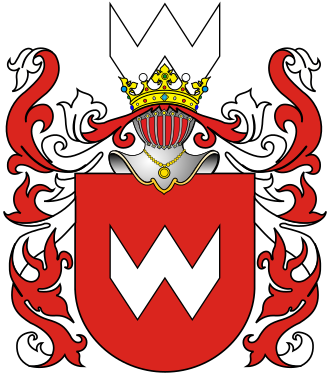

# Family Hub — семья Виговских



Закрытое семейное веб-приложение: задачи и бытовые проекты, обслуживание дома, статусы в пути,
общая папка билетов (под 2FA), тематические чаты и «умные» уведомления. Без алгоритмических лент,
без посторонних пользователей, без индексации поисковиками.

**Стек:** Laravel 13 (PHP 8.3) · Sanctum (SPA-сессии) · Vue 3 + Vue Router · Tailwind CSS 4 ·
SQLite (разработка) / PostgreSQL (прод) · локальный диск или S3 · Web Push (VAPID).

---

## Быстрый старт (локально)

```bash
composer install
npm install
cp .env.example .env          # Windows: copy .env.example .env
php artisan key:generate
php artisan migrate
npm run build                 # или `npm run dev` для горячей перезагрузки
php artisan serve             # http://localhost:8000
```

Откройте сайт: пока в базе нет ни одной семьи, страница входа предложит **«Создать новую семью»** —
вы станете администратором. Дальше регистрация закрывается, родственники приходят только
по ссылкам-приглашениям (раздел «Семья»).

Демо-данные семьи Виговских (задачи, поездка, билет, чаты): `php artisan migrate:fresh --seed`.
Аккаунты (пароль `demo-password`, только для локальной разработки):
`papa@vigovsky.test` (Николай, папа), `mama@vigovsky.test` (Татьяна, мама), `nikolay@vigovsky.test` (Николай) —
администраторы; `yuriy@vigovsky.test` (Юрий), `maria@vigovsky.test` (Мария) — участники.
Роли меняются в разделе «Семья».

Альтернатива из консоли:

```bash
php artisan family:create                  # семья + первый администратор
php artisan family:invite 1 --role=viewer  # одноразовая ссылка для бабушки
```

Для пуш-уведомлений: `php artisan push:vapid` → вставьте ключи в `.env`; очередь: `php artisan queue:work`.
Напоминания и бэкапы: `php artisan schedule:work` (в проде — cron `* * * * * php artisan schedule:run`).

Тесты: `php artisan test` (17 feature-тестов: изоляция семей, роли, приглашения, 2FA, сброс пароля, сжатие фото, чек-листы,
уведомления, бэкапы).

### PhpStorm

Откройте папку проекта → PhpStorm подхватит `composer.json`, PHPUnit (`phpunit.xml`) и Vite.
Рекомендуется плагин **Laravel Idea**; интерпретатор PHP 8.3; для отладки — Xdebug.

---

## Роли

| Роль | Возможности |
|---|---|
| **Администратор** | Всё + приглашения, роли, исключение участников, настройки и скачивание резервных копий |
| **Участник** | Задачи, чаты, статусы в пути, билеты и брони (после 2FA) |
| **Наблюдатель** | Только просмотр: упрощённый интерфейс с крупными плитками, фото, статусы, сообщения. Любой изменяющий запрос API отклоняется (403) |

Один человек может состоять в нескольких семьях (переключатель в разделе «Семья»).

**Забытый пароль.** «Забыли пароль?» на странице входа присылает письмо со ссылкой (нужна настройка почты,
`MAIL_*` в `.env`; локально письмо пишется в `storage/logs/laravel.log`). Для родственников, которые не читают
почту, администратор в разделе «Семья» → участник → «Ссылка для сброса пароля» получает одноразовую ссылку
и передаёт её лично. Ссылка действует 12 часов (`AUTH_PASSWORD_RESET_EXPIRE`, в минутах). Для человека,
который состоит и в другой семье, такая ссылка недоступна — он сбрасывает пароль сам.

---

## Модули

**3.1 Дом и проекты**
- Канбан-доска (Нужно сделать / В работе / Готово) с категориями «Покупки», «Ремонт техники»,
  «Установка оборудования», «Дом» (настраиваются). Drag & drop на десктопе, кнопка «→ далее» на телефоне.
- Карточка задачи: чек-лист (спецификации проводки, аккумуляторов), ссылки на магазины с ценой,
  фото «до» / «после», кнопка «Обсудить в чате» (создаёт связанную тему).
- Регулярные дела: замена расходников, проверка фильтров, оплата электроэнергии с показаниями
  **день (T1) / ночь (T2)** и суммой. «Сделано» → следующий срок пересчитывается автоматически.
  Календарь месяца (на телефоне — список) + ежедневные напоминания в 09:00.

**Фото** сжимаются прямо в браузере перед загрузкой: снимок с телефона 5–10 МБ превращается в JPEG ~200–600 КБ
(до 1920 px; сканы билетов — до 2560 px, чтобы штрихкод читался) плюс превью ~40 КБ для сеток. Повторное
кодирование удаляет EXIF, включая GPS-координаты места съёмки. PDF и форматы, которые браузер не умеет
открыть, загружаются как есть. Серверу не нужны GD/Imagick.

**3.2 Логистика и путешествия**
- Кнопки быстрого статуса: «Еду в аэропорт», «Граница пройдена», «На месте», «Уже дома»,
  «Задержка», «Нужна помощь» и др. (нейтральные формулировки — одинаково подходят всем членам семьи),
  с комментарием и (по желанию) геопозицией.
- Поездки с участниками; у каждой поездки своя тема в чате.
- Билеты и брони: рейс/номер, код брони, откуда-куда, время, файлы (PDF, фото, .pkpass), поиск по номеру рейса.
  **Доступ только после 2FA** (TOTP + резервные коды), подтверждение действует 12 часов.

**3.3 Общение и уведомления**
- Тематические ветки вместо одного чата; непрочитанные, закрепление, отключение уведомлений темы.
- Каналы уведомлений: `logistics` — **срочные** (Web Push со звуком/вибрацией, `urgency: high`,
  не исчезают сами; в открытом приложении — жёлтый баннер и сигнал); `projects`, `maintenance`,
  `chat`, `family` — **тихие**. Каждый канал отключается в настройках.

**Доступность:** крупный шрифт по умолчанию (4 размера), режим высокой контрастности, кнопки ≥ 48 px,
иконки всегда с подписью, видимый фокус, навигация с клавиатуры, `prefers-reduced-motion`,
Mobile First (нижняя навигация на телефоне, боковая — на десктопе). PWA: можно установить на экран «Домой».

---

## Архитектура

```
app/
  Enums/            Role, CheckinType
  Models/           Family, FamilyMember, Invitation, Task, ChecklistItem, TaskLink, Attachment,
                    MaintenanceItem, MaintenanceLog, Trip, Checkin, TravelDocument, Thread,
                    Message, FamilyNotification, PushSubscription
  Models/Concerns/  BelongsToFamily — глобальный scope по family_id
  Http/Middleware/  SetFamilyContext, EnsureCanWrite, EnsureFamilyAdmin, RequireTwoFactor, PrivateSite
  Http/Controllers/Api/   REST API
  Services/         Notifier (каналы/срочность), TwoFactor (TOTP), FamilyBackup (zip)
  Jobs/             SendWebPush
routes/api.php      все эндпоинты
routes/console.php  family:create, family:invite, maintenance:remind, family:backup, push:vapid + расписание
resources/js/       Vue SPA (pages/, components/, store.js, api.js)
public/sw.js        service worker для Web Push
```

**Изоляция семей.** Каждая доменная таблица содержит `family_id`. Middleware `SetFamilyContext`
определяет текущую семью пользователя *до* route model binding, а трейт `BelongsToFamily` добавляет
глобальный scope — объект чужой семьи по прямой ссылке отдаёт 404 (покрыто тестом).

### Схема БД (основное)

| Таблица | Ключевые поля |
|---|---|
| `users` | name, email, password (Argon2id), current_family_id, preferences (json), two_factor_* (зашифровано) |
| `families` | name, backup_frequency, backup_keep, last_backup_at |
| `family_members` | family_id, user_id, role (admin/member/viewer), relation |
| `invitations` | family_id, token_hash (sha256), role, max_uses, uses, expires_at, revoked_at |
| `task_categories` | family_id, name, icon, color, position |
| `tasks` | family_id, category_id, assignee_id, title, description, status, priority, due_date, position |
| `task_checklist_items` / `task_links` | task_id, text/is_done · url/title/price |
| `attachments` | family_id, attachable (morph), kind (before/after/other/document), disk, path, thumb_path, mime, size |
| `maintenance_items` / `maintenance_logs` | interval_days, next_due_on, remind_days_before · amount, reading_day, reading_night |
| `trips` / `trip_user` / `checkins` | поездки, участники, статусы (type, note, lat, lng) |
| `travel_documents` | type, reference, booking_code, from/to, departs_at, arrives_at + attachments |
| `threads` / `messages` / `thread_reads` | темы (связь с задачей/поездкой), сообщения, маркер прочтения + mute |
| `family_notifications` / `push_subscriptions` | channel, urgent, read_at · Web Push endpoints |

### REST API (кратко)

Аутентификация: `GET /sanctum/csrf-cookie`, затем запросы с cookie-сессией.

| Метод | Путь | Назначение |
|---|---|---|
| POST | `/api/login`, `/api/logout`, `/api/register` | вход/выход, создание семьи |
| POST | `/api/forgot-password`, `/api/reset-password` | письмо со ссылкой и смена пароля |
| GET/POST | `/api/invitations/{token}`, `.../accept` | приглашения |
| GET | `/api/me`, `/api/dashboard`, `/api/counts` | сессия, главная, счётчики (поллинг) |
| CRUD | `/api/tasks`, `/api/categories` | задачи; `POST /tasks/{id}/move`, `/checklist`, `/links`, `/attachments`, `/thread` |
| CRUD | `/api/maintenance` | регулярные дела; `POST /maintenance/{id}/complete`; `GET /api/calendar?month=YYYY-MM` |
| GET/POST | `/api/checkins`, `/api/checkin-types`, CRUD `/api/trips` | статусы и поездки |
| CRUD | `/api/documents` | билеты и брони (**2FA**, иначе 423) |
| CRUD | `/api/threads`, `/api/threads/{id}/messages` | темы и сообщения (`?after=id` для поллинга) |
| GET/POST | `/api/notifications`, `/notifications/read`, `/push/subscribe` | уведомления |
| GET/POST/DELETE | `/api/two-factor`, `/setup`, `/confirm`, `/verify` | 2FA |
| * | `/api/family/...` | администрирование (только admin) |

Полный список: `php artisan route:list --path=api`.

---

## Безопасность и приватность

- `robots.txt: Disallow: /`, заголовок `X-Robots-Tag: noindex, nofollow, noarchive` на каждом ответе,
  `<meta name="robots">`; опционально HTTP Basic Auth на весь сайт (`FAMILYHUB_BASIC_AUTH_*` или `auth_basic` в nginx).
- Пароли — Argon2id (`HASH_DRIVER=argon2id`), минимум 10 символов; rate limit на вход, приглашения и 2FA.
- 2FA (TOTP) обязательна для модуля документов; секрет и резервные коды хранятся зашифрованными.
- Ссылки-приглашения: 48 случайных символов, в БД — только sha256-хеш, одноразовые, с истечением.
- Файлы никогда не публичны: отдаются только через `/api/attachments/{id}` после проверки семьи (и 2FA для документов).
- Сессии зашифрованы (`SESSION_ENCRYPT=true`), заголовки `X-Frame-Options: DENY`, `nosniff`, `Referrer-Policy: same-origin`.
- Без сторонних CDN и шрифтов: в браузере нет запросов к внешним сервисам (кроме карты по клику).

---

## Деплой

**Docker** (`docker-compose.yml`): Caddy (автоматический HTTPS) + nginx + php-fpm + очередь + планировщик +
PostgreSQL + MinIO (S3). На чистом сервере с Docker:

```bash
./deploy.sh init semya.example.ru you@example.com   # секреты, сборка, миграции, первый администратор
./deploy.sh                                         # последующие обновления
```

Пошагово (сервер, домен, deploy key, почта, автодеплой, бэкапы): [docs/DEPLOY.md](docs/DEPLOY.md).

**CI/CD** (`.github/workflows/ci.yml`): на каждый push/PR — сборка фронтенда, Pint, тесты на SQLite
и PostgreSQL. Деплой по SSH в ветке `main` включается переменной репозитория `DEPLOY_ENABLED=true`
и секретами `DEPLOY_HOST`, `DEPLOY_USER`, `DEPLOY_SSH_KEY`, `DEPLOY_PATH`.

---

## Дорожная карта (после MVP)

- WebSocket (Laravel Reverb) вместо поллинга для чатов и статусов.
- E2EE для личных чатов (libsodium / MLS) — архитектура тем это допускает: тело сообщения можно хранить как шифротекст.
- Восстановление семьи из архива бэкапа (`family:restore`).
- Распознавание посадочных талонов (PDF/QR) и автозаполнение рейса.
- Совместный список покупок с отметкой «купил» в реальном времени.
